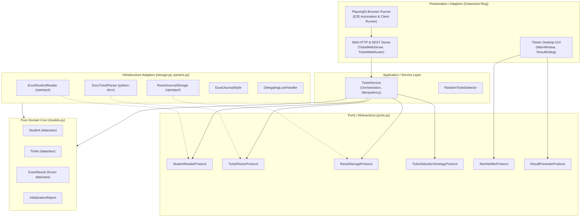
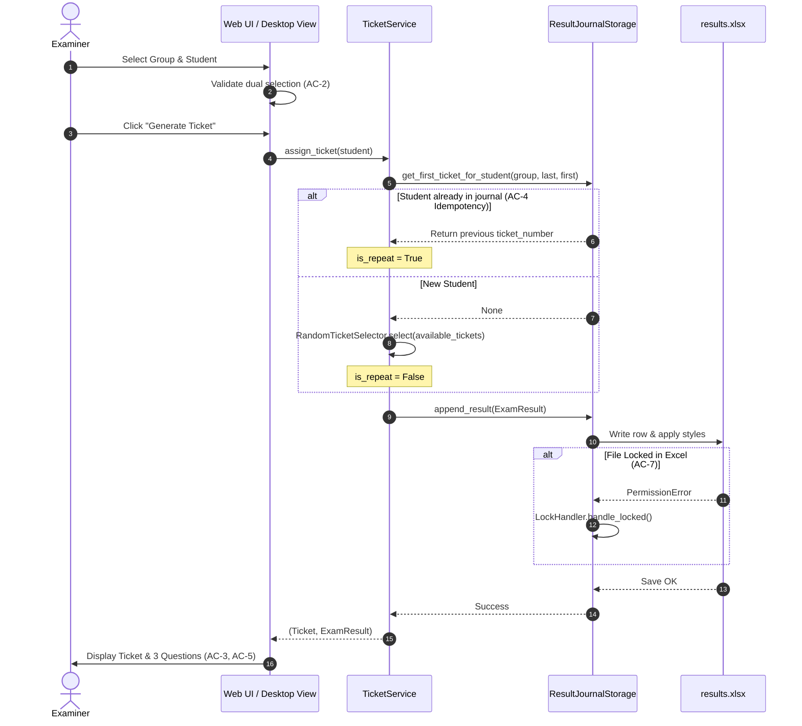

# Architectural Blueprint & Technical Plan

> **Framework:** Hexagonal Architecture (Ports and Adapters)  
> **Target Runtimes:** Python 3.12+ (tested up to 3.14.2)  
> **Adherence:** SOLID, Clean Code, Clean Architecture

---

## 1. System Architecture Overview

The system is organized into concentric decoupled rings:

---

## 2. Component Protocols & Responsibility Matrix

| Protocol | Responsibility | Concrete Implementation |
| :--- | :--- | :--- |
| `StudentReaderProtocol` | Read worksheets and student lists | `ExcelStudentReader` (openpyxl) |
| `TicketParserProtocol` | Parse ticket numbers & questions | `DocxTicketParser` (python-docx) |
| `ResultStorageProtocol` | Query history & append exam records | `ResultJournalStorage` (openpyxl) |
| `JournalStylerProtocol` | Apply corporate / academic cell styles | `ExcelJournalStyler` |
| `LockHandlerProtocol` | Resolve file access permission locks | `DelegatingLockHandler` / `InteractiveLockHandler` |
| `TicketSelectionStrategyProtocol` | Select ticket among valid candidates | `RandomTicketSelector` |
| `TicketServiceProtocol` | Business logic & idempotency | `TicketService` |
| `ResultPresenterProtocol` | Render ticket results dialog/modal | `TkResultPresenter` / `TicketWebRouter` |
| `AlertNotifierProtocol` | Alert user regarding errors/warnings | `TkAlertNotifier` / Web Alert Banner |

---

## 3. Sequence: Ticket Assignment & Persistence

---

## 4. Production Engineering Protocols

1. **Configuration Protocol**: Typed `AppConfig` with environment variable overrides.
2. **Logging Protocol**: Structured standard logging with level filtering.
3. **Packaging Protocol**: `py.typed` marker for static typing checkers.
4. **Resilience Protocol**: Automatic exponential backoff retries on file sharing locks.
